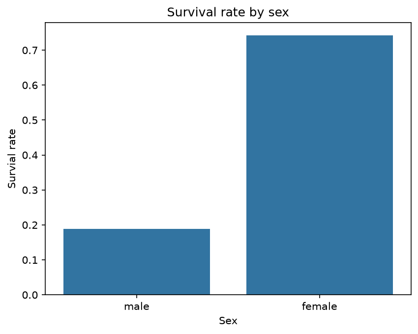
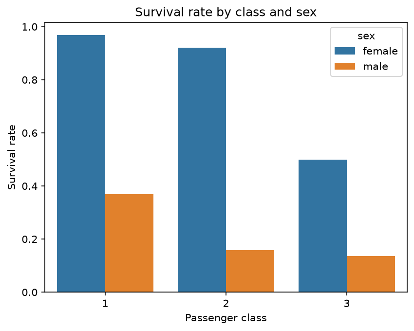
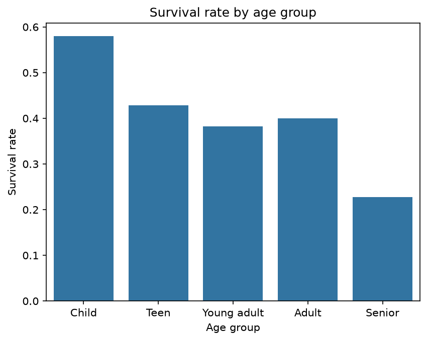

# Titanic Survival Analysis

Exploratory data analysis of the Titanic passenger dataset, to find out which factors were linked to survival.

## Questions
- Did sex, passenger class and age affect the chances of survival?

## Data
Titanic dataset (891 passengers, 15 columns) loaded from the seaborn library.

## Tools
Python, pandas, seaborn, matplotlib, Jupyter.

## Key findings
- Overall survival rate was 38.4%.
- Women survived far more than men (74.2% vs 18.9%).
- Survival increased with passenger class (63.0%, 47.3% and 24.2% for 1st, 2nd and 3rd class).
- Sex mattered more than class: third-class women survived more often than first-class men.
- Children had the highest survival rate of any age group.

## Charts

## How to run
1. Clone the repository.
2. Install dependencies: `pip install -r requirements.txt`
3. Open `notebooks/01_titanic_analysis.ipynb` and run all cells.